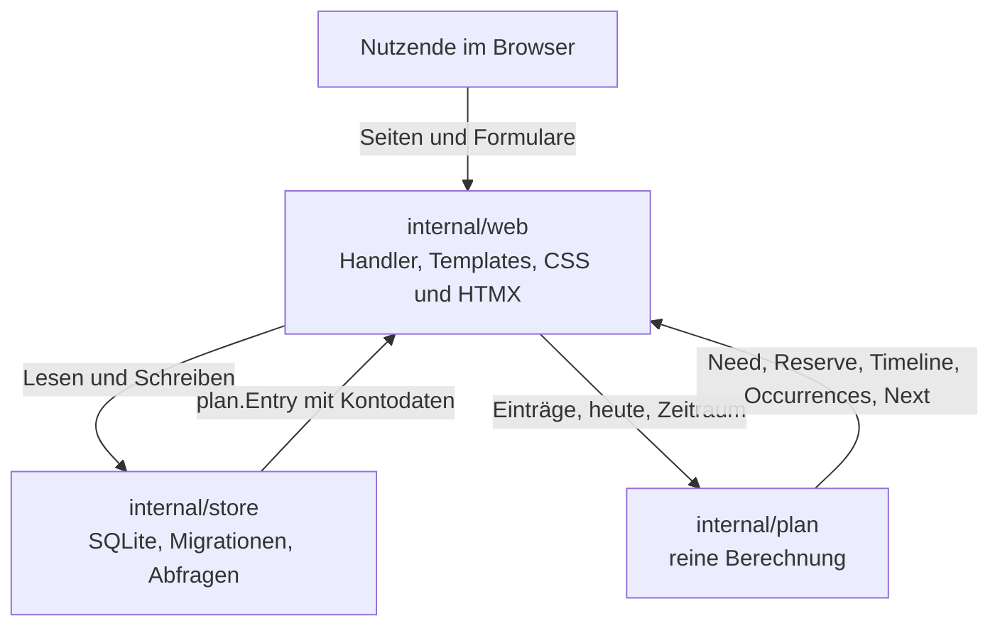

# Architektur

EasyPlan besteht aus vier Bausteinen. Jeder Baustein hat eine klare Aufgabe, und die Abhängigkeiten laufen in eine Richtung: `internal/web` nutzt `internal/store` und `internal/plan`, `internal/store` nutzt `internal/plan`, `internal/plan` kennt kein anderes Paket.

| Baustein | Aufgabe | Stand in Phase 1 |
|---|---|---|
| `cmd/easyplan` | Start, Konfiguration aus der Umgebung | Gerüst: liest die Konfiguration und meldet sie |
| `internal/store` | SQLite, Migrationen, Abfragen | fertig |
| `internal/plan` | reine Berechnung, ohne I/O | fertig |
| `internal/web` | HTTP-Handler, Templates, statische Dateien | leer, nur Paketdokumentation |

## Datenfluss



Ein Request läuft immer über das Web-Paket: es liest die Daten über den Store, rechnet mit dem Plan-Paket und gibt das Ergebnis als HTML zurück. Der Store rechnet nicht, und das Plan-Paket weiss nichts von der Datenbank.

## Reinheit von `internal/plan`

Das Paket führt kein I/O aus und liest die Uhr nie. Der Aufrufer übergibt „heute“ und die Bereichsgrenzen ausdrücklich:

```go
need := plan.Totals(entries)
reserve := plan.Reserve(entries, today, 30)
```

Daraus folgt:

- Gleiche Eingabe, gleiches Ergebnis, unabhängig von Zeitzone und Aufrufzeitpunkt.
- Die Berechnung lässt sich vollständig testen, ohne Datenbank und ohne feste Uhrzeit.
- Dashboard, Reserve und Timeline berechnen ihre Termine mit demselben Kern `nth`, können also nicht auseinanderlaufen.

Ein Test im Paket (`purity_test.go`) prüft, dass keine Datei `time.Now()` aufruft.

## Datumskonvention

Ein Datum ist ein Kalendertag, kein Zeitpunkt.

- In der Datenbank steht ein Text im Format `YYYY-MM-DD` ohne Uhrzeit, zum Beispiel `start_date = '2026-10-01'`.
- Im Code ist ein Kalendertag ein `time.Time` auf 00:00:00 UTC ohne Zeitzonenzuordnung.
- `plan.ParseDate` und `plan.FormatDate` sind die einzigen Wege zwischen Text und Zeitstempel. Der Store nutzt sie für alle Datumswerte.
- Jedes Datumsargument gilt als der Kalendertag seines Zeitstempels. Ein Zeitstempel aus der lokalen Zeit behält seinen Tag, auch wenn die Zeitzone wechselt.
- Unterstützt sind die Jahre 1 bis 9999. Die Berechnung braucht diese Grenze, damit Monats- und Tagesrechnung nirgends überlaufen.

Diese Konvention macht die Tagesrechnung immun gegen Sommerzeit-Übergänge: zwischen zwei Kalendertagen liegen immer genau 24 Stunden.

## Termine

Termine entstehen nur in `internal/plan`. `plan.Occurrences` liefert alle Termine eines Eintrags im halb offenen Bereich `[from, to)`:

- `plan.Next` sucht den ersten Termin ab einem gegebenen Tag.
- `plan.Reserve` summiert die Beträge aller Termine in einem Zeitraum.
- `plan.Timeline` sammelt die Termine aller Einträge und sortiert sie nach Datum, dann nach Konto, Name und Kennung.

`Occurrences` und `Next` teilen sich den Kern `nth`, in dem der n-te Termin aus dem Startdatum berechnet wird. `Next` greift dafür direkt auf `nth` zu, nicht auf `Occurrences`. `Reserve` und `Timeline` rufen `Occurrences` auf. Weil alle denselben Kern verwenden, liefern sie für denselben Eintrag und denselben Tag denselben Termin.

Die Regeln für Einheiten, Intervalle und das Monatsende stehen unter [Wiederholungen](features/wiederholungen.md).

## Nächster Schritt

`internal/web` und der Server in `cmd/easyplan` folgen mit Phase 2. Bis dahin existieren nur die Bausteine `internal/plan` und `internal/store`.
