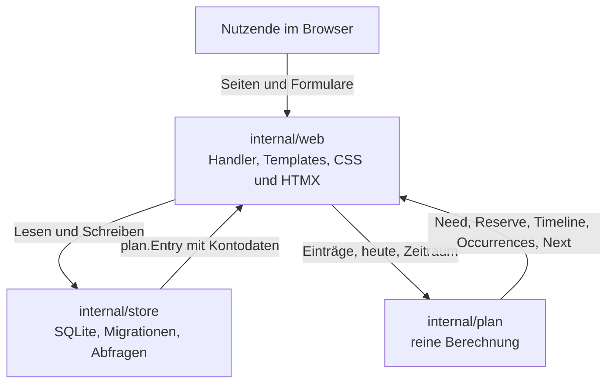

# Architektur

EasyPlan besteht aus vier Bausteinen. Jeder Baustein hat eine klare Aufgabe, und die Abhängigkeiten laufen in eine Richtung: `internal/web` nutzt `internal/store` und `internal/plan`, `internal/store` nutzt `internal/plan`, `internal/plan` kennt kein anderes Paket.

| Baustein | Aufgabe | Stand in Phase 2 |
|---|---|---|
| `cmd/easyplan` | Start, Konfiguration aus der Umgebung, HTTP-Server | fertig |
| `internal/store` | SQLite, Migrationen, Abfragen | fertig |
| `internal/plan` | reine Berechnung, ohne I/O | fertig |
| `internal/web` | HTTP-Handler, Templates, statische Dateien | fertig |

## Datenfluss



Ein Request läuft immer über das Web-Paket: es liest die Daten über den Store, rechnet mit dem Plan-Paket und gibt das Ergebnis als HTML zurück. Der Store rechnet nicht, und das Plan-Paket weiss nichts von der Datenbank.

## Reinheit von `internal/plan`

Das Paket führt kein I/O aus und liest die Uhr nie. Der Aufrufer übergibt „heute“ und die Bereichsgrenzen ausdrücklich:

```go
need := plan.Totals(entries)
reserve := plan.Reserve(entries, today, 30)
```

Daraus folgt:

- Gleiche Eingabe, gleiches Ergebnis, unabhängig von Zeitzone und Aufrufzeitpunkt.
- Die Berechnung lässt sich vollständig testen, ohne Datenbank und ohne feste Uhrzeit.
- Dashboard, Reserve und Timeline berechnen ihre Termine mit demselben Kern `nth`, können also nicht auseinanderlaufen.

Ein Test im Paket (`purity_test.go`) prüft, dass keine Datei `time.Now()` aufruft.

## Datumskonvention

Ein Datum ist ein Kalendertag, kein Zeitpunkt.

- In der Datenbank steht ein Text im Format `YYYY-MM-DD` ohne Uhrzeit, zum Beispiel `start_date = '2026-10-01'`.
- Im Code ist ein Kalendertag ein `time.Time` auf 00:00:00 UTC ohne Zeitzonenzuordnung.
- `plan.ParseDate` und `plan.FormatDate` sind die einzigen Wege zwischen Text und Zeitstempel. Der Store nutzt sie für alle Datumswerte.
- Jedes Datumsargument gilt als der Kalendertag seines Zeitstempels. Ein Zeitstempel aus der lokalen Zeit behält seinen Tag, auch wenn die Zeitzone wechselt.
- Unterstützt sind die Jahre 1 bis 9999. Die Berechnung braucht diese Grenze, damit Monats- und Tagesrechnung nirgends überlaufen.

Diese Konvention macht die Tagesrechnung immun gegen Sommerzeit-Übergänge: zwischen zwei Kalendertagen liegen immer genau 24 Stunden.

## Termine

Termine entstehen nur in `internal/plan`. `plan.Occurrences` liefert alle Termine eines Eintrags im halb offenen Bereich `[from, to)`:

- `plan.Next` sucht den ersten Termin ab einem gegebenen Tag.
- `plan.Reserve` summiert die Beträge aller Termine in einem Zeitraum.
- `plan.Timeline` sammelt die Termine aller Einträge und sortiert sie nach Datum, dann nach Konto, Name und Kennung.

`Occurrences` und `Next` teilen sich den Kern `nth`, in dem der n-te Termin aus dem Startdatum berechnet wird. `Next` greift dafür direkt auf `nth` zu, nicht auf `Occurrences`. `Reserve` und `Timeline` rufen `Occurrences` auf. Weil alle denselben Kern verwenden, liefern sie für denselben Eintrag und denselben Tag denselben Termin.

Die Regeln für Einheiten, Intervalle und das Monatsende stehen unter [Wiederholungen](features/wiederholungen.md).

## Die Web-Schicht

Das Paket `internal/web` erzeugt den Handler der Anwendung. Seine Dateien:

| Datei | Aufgabe |
|---|---|
| `web.go` | Konstruktor, Routen, `PageData`, Rendern der Seiten |
| `templates.go` | die eingebetteten Templates und die Template-Funktionen |
| `static.go` | die eingebetteten statischen Dateien (CSS und HTMX) |
| `origin.go` | die Middleware, die die Herkunft der schreibenden Requests prüft |
| `security.go` | die Middleware, die die Sicherheits-Header setzt |
| `money.go` | Formatieren und Parsen der Beträge, Formatieren der Daten |
| `active.go` | die Einträge, die in den Auswertungen zählen |
| `summary.go` | die Werte des Dashboards |
| `dashboard.go` | die Seite des Dashboards und die Auswahl der Reserve |
| `entries.go` | die Liste der Einträge und das Löschen |
| `entryform.go` | das Formular eines Eintrags und seine Prüfung |
| `accounts.go` | die Seite der Konten und ihre Aktionen |
| `timeline.go` | die Seite der Timeline und ihre Monatsgruppen |

### Ein Muster für alle Seiten

Jede Seite bekommt dieselben Daten:

```go
type PageData struct {
    Title  string            // der Titel der Seite
    Active string            // der Eintrag der Navigation, der aktiv ist
    Errors map[string]string // die Fehler der Felder, nach Feldnamen
    Error  string            // ein Hinweis für die ganze Seite
    Data   any               // die Daten der Seite selbst
}
```

Das Layout zeigt Titel, Navigation und Meldungen, ohne die Seite zu kennen. Die `Errors`-Map trägt die Fehler der Prüfung, nach dem Namen des Feldes, damit das Template sie beim richtigen Feld zeigen kann.

### Reine Funktionen neben den Handlern

Die Handler lesen den Store und rendern die Seite. Die Logik, die sich ohne Server prüfen lässt, steht in reinen Funktionen:

| Funktion | Aufgabe |
|---|---|
| `BuildSummary` | die Werte des Dashboards aus Konten und Einträgen |
| `ValidateEntryForm` | die Prüfung des Eintragsformulars |
| `ValidateAccountName` | die Prüfung eines Kontonamens |
| `AccountRows` | die Zeilen der Kontenliste |
| `BuildTimeline` | die Monatsgruppen und die Ereignisse der Timeline |
| `ParseAccountFilter` | die Kennung des Kontofilters der Query-Zeichenkette |
| `ParseAmount` | ein Betrag aus dem Text in Rappen |

Sie lesen nichts ausser ihren Argumenten und rufen weder die Datenbank noch die Uhr. Ein Test kann sie deshalb ohne Server und mit einem festen Datum prüfen.

### Die Zeit

Die Handler lesen die Uhr nie selbst. Der Konstruktor bekommt eine Funktion (`Options.Now`) und die Zeitzone (`Options.Location`). Der Start in `cmd/easyplan` setzt die Zone einmal global über `time.Local` und gibt sie der Web-Schicht zusätzlich, damit die Handler nicht über die globale Variable gehen müssen.

## Nächster Schritt

Phase 3 bringt den Betrieb: Container, Compose-Datei, `/health`, der Backup-Button, der Restore und der GitHub-Actions-Workflow. Die Bedienung der App steht unter [Oberfläche](features/oberflaeche.md), der Start unter [Server und Betrieb](features/server.md).
